<p align="center">
  
</p>

<p align="center">
  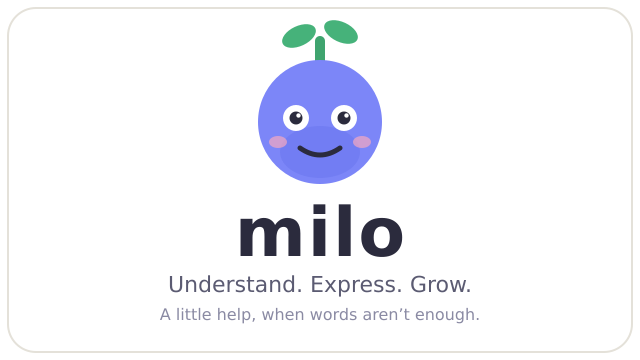
</p>

<p align="center">
  <a href="https://flutter.dev"></a>
  <a href="https://dev.meta.ai"></a>
  <a href="https://modal.com"></a>
</p>

<p align="center"><strong>A little help, when words are not enough.</strong></p>

## What Milo is

Milo is an adaptive AI companion for communication, comprehension, and everyday independence, for children and adults with dyslexia, speech-language needs, and other communication difficulties. It helps people **understand** (read and explain text, worksheets, photos), **express** (boards, compose, speech), and **do** (step-by-step plans), through a companion character that looks, listens, waits, and reacts instead of a stream of text bubbles.

General-purpose chatbots assume fluent reading, typing, and self-direction. Milo's users (a pre-reader child, a teenager with dyslexia, an adult filling in forms, a person who communicates with symbols) need the opposite: spoken interaction, patient pacing, visual structure, huge touch targets, and tools that keep working with no connection. Five tabs (Home, Explore, Milo, Progress, More), an always-available Break and Help me in every header, and an offline-first ladder where the board, read-aloud, routines, and memory never need the internet.

<p align="center">
  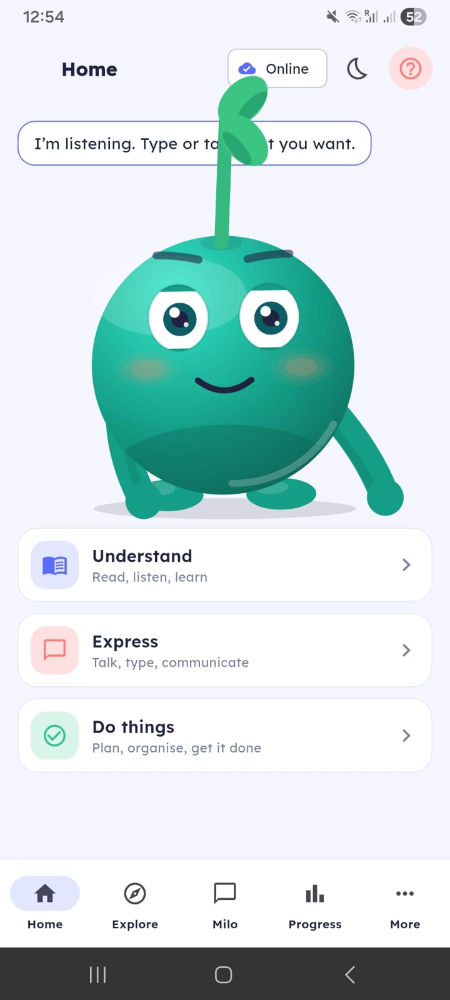
  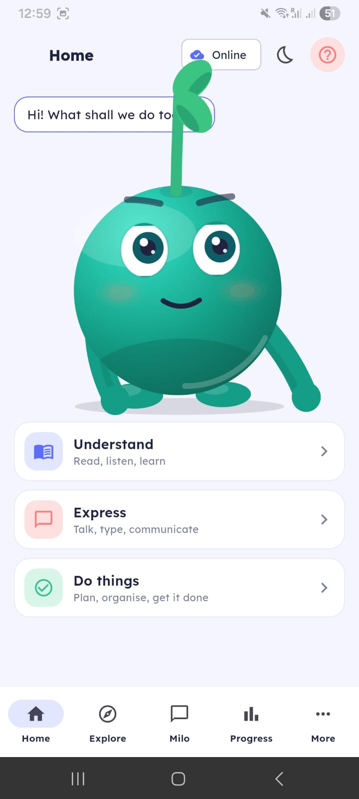
</p>

<p align="center"><em>Home: the companion and the three front doors (Understand, Express, Do things).</em></p>

The model decides what to say; deterministic app code decides what happens. Every model output is validated against closed contracts before anything reaches the screen, the speaker, storage, or the network, and every cloud call is written to an on-device ledger *before* it is sent.

Built for the **Meta Global AI Developer Hackathon** (October-November 2026 build window) by Arjun.

## Demo video

> **Three-minute demo video: coming soon.** Planned walkthrough: onboard in under 90 seconds, build and speak a board message offline, photograph a worksheet and hear it explained, generate and listen to a story, then open the trusted-adult area to show the ledger and AI connections. This section will hold the embedded video link.

## Product overview

The five sheets below are the **original pre-build design wireframes** (drawn from the 23 October 2026 blueprint, [Milo_Architecture_and_Build_Plan.pdf](Milo_Architecture_and_Build_Plan.pdf)). They show the intended journeys; the as-built application map and the screenshots further down show what is implemented. Where the build differs from a sheet, the feature text says so.

### 1. Onboarding and the interaction engine

<p align="center">
  <a href="docs/images/wireframes/wireframe-1-onboarding-engine.png">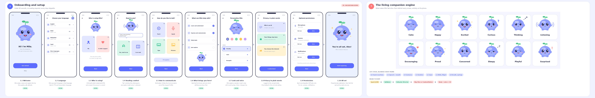</a>
</p>

<p align="center"><em>Sheet 1: ten setup steps (welcome, language, who is using, reading comfort, talk style, goals, look and voice, privacy in plain words, permissions, all set) plus the living companion engine with twelve expressions and its life stack. Click for full resolution.</em></p>

### 2. Home, Understand, Express

<p align="center">
  <a href="docs/images/wireframes/wireframe-2-home-understand-express.png">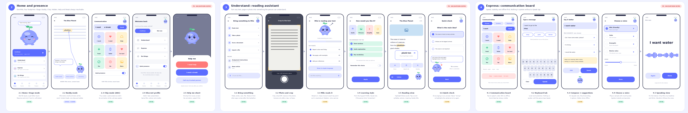</a>
</p>

<p align="center"><em>Sheet 2: presence modes (stage, buddy, chip, discreet, help sheet), the Understand reading assistant (bring, crop, read, style, reading view, quick check), and the Express board (board, keyboard, compose, voice, speaking view). Click for full resolution.</em></p>

### 3. Learn, Do, Chat, Progress

<p align="center">
  <a href="docs/images/wireframes/wireframe-3-learn-do-chat-progress.png">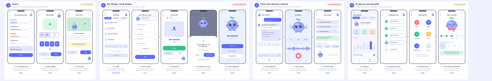</a>
</p>

<p align="center"><em>Sheet 3: learning journey with word builder and story time, guided tasks with confirm-before-action, chat with voice input and context chips, and progress counts with growth and wardrobe. Click for full resolution.</em></p>

### 4. Calm, trust, settings, pre-reader

<p align="center">
  <a href="docs/images/wireframes/wireframe-4-calm-trust-settings-prereader.png">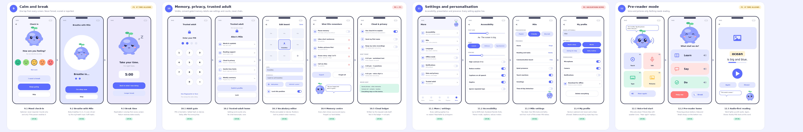</a>
</p>

<p align="center"><em>Sheet 4: mood check-in, breathing, and break timer; PIN gate, grown-up home, vocabulary editor, memory centre, and cloud ledger; accessibility, Milo, and profile settings; and the voice-led pre-reader mode. Click for full resolution.</em></p>

### 5. Offline, integration, how it fits together

<p align="center">
  <a href="docs/images/wireframes/wireframe-5-offline-integration.png">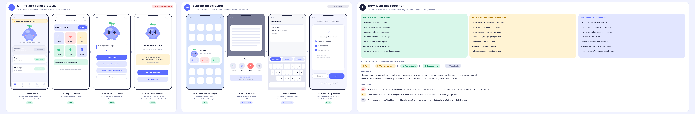</a>
</p>

<p align="center"><em>Sheet 5: offline home and failure states; widget, share, keyboard, and screen-help surfaces (design-only, not built); and the fit-together map of on-phone stack, Meta Model API stack, offline ladder, guardrails, and build order. Click for full resolution.</em></p>

### As-built application map

<p align="center">
  <a href="docs/images/app-wireflow.svg">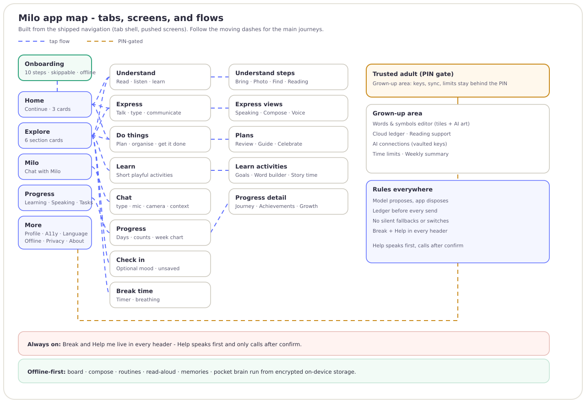</a>
</p>

<p align="center"><em>The shipped navigation traced from code: tab shell, pushed screens, the PIN-gated grown-up area, and the rules that hold everywhere. Follow the moving dashes for the main journeys.</em></p>

## Core features

Everything below is the implemented application. Each feature names its screenshot (device capture), its offline behavior, and the model or local code behind it.

<p align="center">
  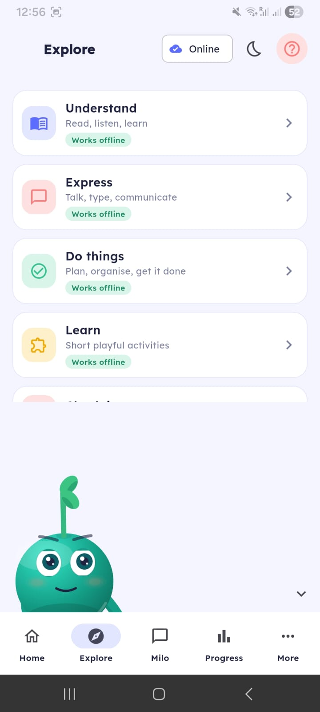
  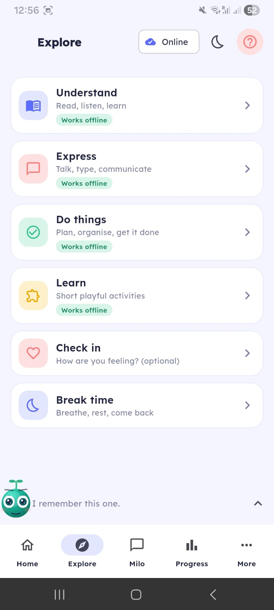
</p>

<p align="center"><em>The implemented tab shell: Explore lists every section and badges what works offline.</em></p>

### Understand

Read and explain text, worksheets, and photos.

Bring text, a photo, a file, or a saved document; Milo reads it, pulls out key points, simplifies on request, and checks vocabulary, switching strategy (simpler, picture, example, short) when something does not land. Photos get on-device OCR for read-aloud plus tap-a-box object explanations.

Device capture pending in this pass. Offline: OCR and read-aloud run on-device. Online: hosted Spark text and vision turns (staging-verified, including a photo run); SAM object boxes still need their keyed run.

### Express

Say things with pictures, words, or typing.

Tap picture tiles to build a message, then speak it aloud with large listener-facing text. Fixed tile positions, recents, an urgent Help row, Phrases/Symbols/Keyboard tabs, and "Say it better" for polishing wording stay predictable under stress.

<p align="center">
  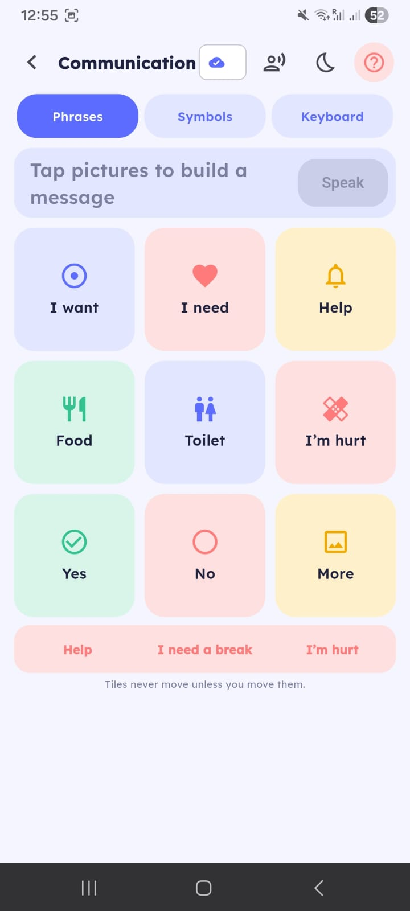
  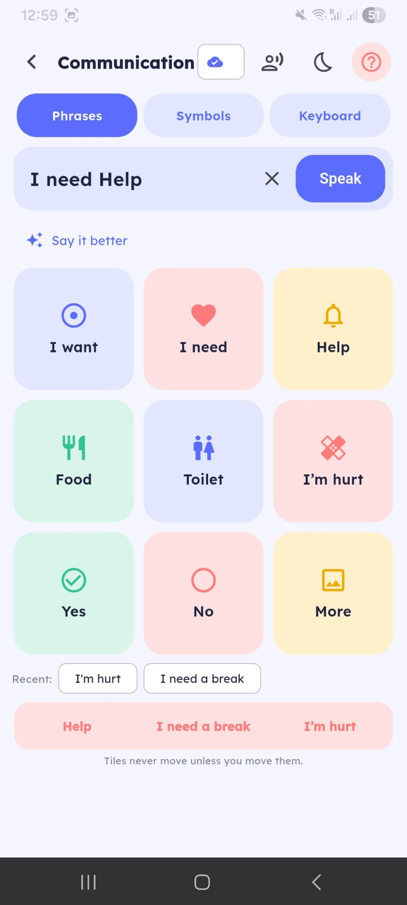
  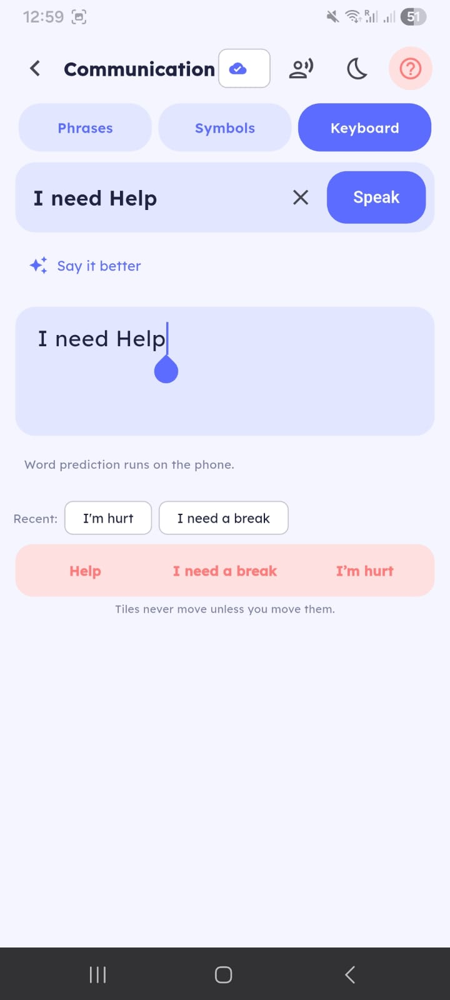
  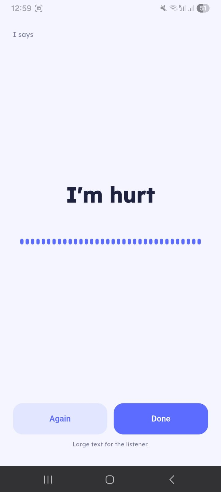
</p>

<p align="center"><em>Express: board, composed message with recents, keyboard with on-device prediction, and the large-text speaking view.</em></p>

Offline: board, prediction, and platform TTS speech. Online: wording polish and word explanations via hosted Spark.

### Do things

Get through routines one step at a time.

Suggested routines plus the person's own tasks and plans. Each plan opens into a guided step mode with Done/Skip/Help, celebration at the end, and hand-off back to Express when words are needed. Calls always ask first.

<p align="center">
  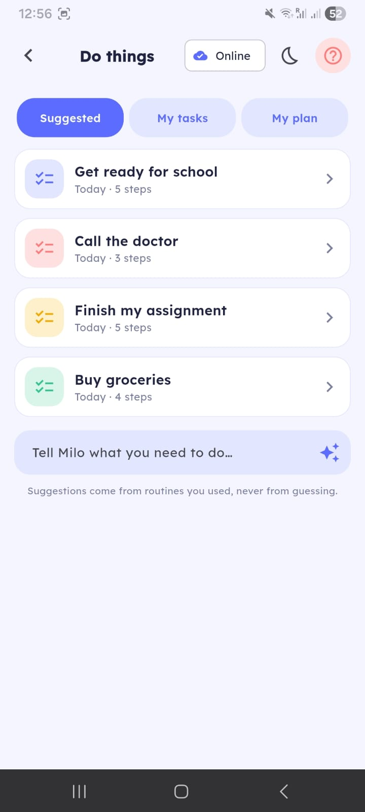
</p>

<p align="center"><em>Do things: suggested routines and custom task entry.</em></p>

Offline: routines, guidance, and celebration are local. Online: plans from `/v1/plan` on hosted Spark.

### Learn

Playful practice plus generated stories.

Goals, a word builder that works fully offline from bundled data, and StoryTime: generated tales with Listen, Back/Next paging, Ask about the story, AI-drawn illustrations, and Save.

Device capture pending in this pass. Offline: word builder and saved stories. Online: `/v1/story` on hosted Spark (staging-verified); illustrations need a Meta Image key and an explicit Create tap each time.

### Chat with Milo

A conversation that shows its work.

Context-aware conversation by text, microphone, or camera, with read-last-answer, saved-message actions, and context chips showing exactly what was sent. Typed input always works; voice input transcribes speech.

Device capture pending in this pass. Offline: the pocket brain keeps simple turns going. Online: SSE brain turns on hosted Spark; transcription needs a Meta Voice key.

### Progress

Counts that encourage, never scores.

Days-together streak, Learning/Speaking/Tasks tabs, counts (stories, words, steps), and a weekly chart. Counts only, never chat contents.

<p align="center">
  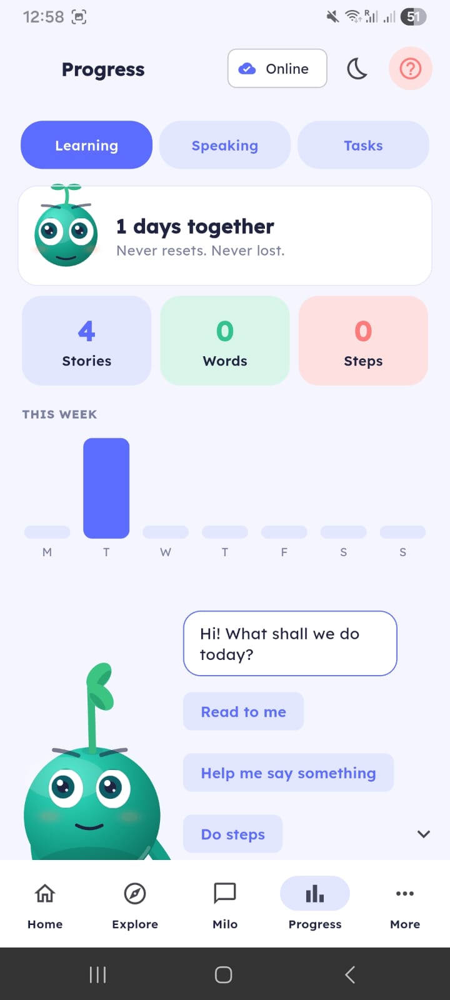
</p>

<p align="center"><em>Progress: days together, counts, and the weekly chart.</em></p>

Fully local (encrypted SQLite).

### Calm

A break that is always one tap away.

Break timer with guided breathing, and an optional five-face mood check-in that is never scored and never leaves the phone without opt-in.

Device capture pending in this pass. Fully local.

### Trusted adult

Grown-up controls behind a PIN.

PIN-gated area: words-and-symbols editor (custom tiles with local AI art), reading support, cloud and privacy switches, AI connections with per-capability activation, gentle time limits, and a progress-only weekly summary.

<p align="center">
  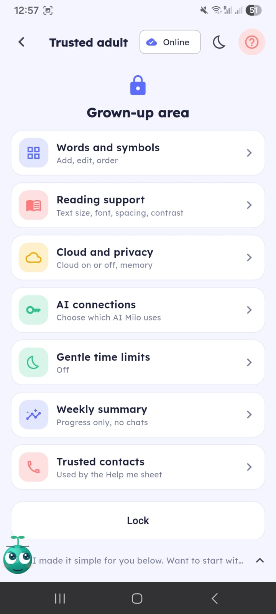
</p>

<p align="center"><em>Trusted adult: the PIN-gated grown-up area.</em></p>

Provider keys are sealed server-side, travel per-request over TLS, and never appear in logs or bundles; family spend never touches the deployer budget.

### Screenshot to implementation map

| Screenshot | Screen | Implementation |
|---|---|---|
| `companion-home.jpeg`, `home-greeting.jpeg` | Home tab | `lib/ui/home_screen.dart`, `lib/companion/` |
| `explore-top.jpeg`, `explore-all-sections.jpeg` | Explore tab | `lib/ui/explore_screen.dart` |
| `communication-board.jpeg`, `communication-composed.jpeg`, `communication-keyboard.jpeg`, `speaking-view.jpeg` | Express | `lib/ui/express_screen.dart` |
| `do-things.jpeg` | Do things | `lib/ui/do_screen.dart` |
| `progress.jpeg` | Progress | `lib/ui/progress_screen.dart` |
| `more-settings.jpeg` | More | `lib/ui/more_screen.dart` |
| `trusted-adult.jpeg` | Trusted adult | `lib/ui/trusted_screen.dart` |

## How Milo uses Meta models

Two serving paths, kept separate: the deployer's **Modal-hosted Muse Spark Open** endpoint answers Milo's own turns, while **family-provided API keys** (Meta, OpenAI, Anthropic, Gemini-compatible, custom) are sealed in the vault and spend the family's quota. One Meta key funds all five Meta models; each is verified separately and a key accepted for one is never assumed for the others. Statuses come from `gateway/app/providers/meta_catalog.py`, which tests keep honest.

| What Milo does | Model or component | Route | Status |
|---|---|---|---|
| Reasoning, chat, understand, plan, compose, stories | Muse Spark Open 816B | Modal Shared Endpoint (OpenAI-compatible) | Live on staging, ladder green |
| Suite reasoning fallback | muse-spark-1.3 | Meta Model API | Same wire, keyed run pending |
| Story and tile illustrations | muse-image-1.0 | Meta Model API | Wired, keyed run pending |
| Voice input transcription | muse-voice-transcribe-1.0 | Meta Model API (realtime socket) | Wired, device plus keyed run pending |
| Tap-a-box object regions | SAM 3.1 | Meta Model API | Wired; app path refuses until `probe_sam.py` passes with a real key (mock suite labels its boxes `mock`) |
| Long-form plans and stories | muse-wonder-1.0 | Meta Model API | Wired, routable to plans/stories only (server-gated, never a default); keyed run pending |
| Operator-side eval judge | muse-glimmer:30b | Self-hosted (Ollama), never a hosted API | Manual, operator hardware only |
| Speech output | Platform TTS via `flutter_tts` | On-device | Local, no model involved |

Notes: speech-to-text (Muse Voice Transcribe) and text-to-speech (platform TTS) are separate systems; nothing auto-generates pictures (every image needs an explicit Create tap); Wonder serves long-form plans and stories only and stays out of ordinary chat, reading, pictures, voice, and outlines by server-side rule; Glimmer is open-weight and self-hosted, so it is never presented as on-device intelligence or reached through an ordinary API key.

## System architecture

<p align="center">
  <a href="docs/images/architecture.svg">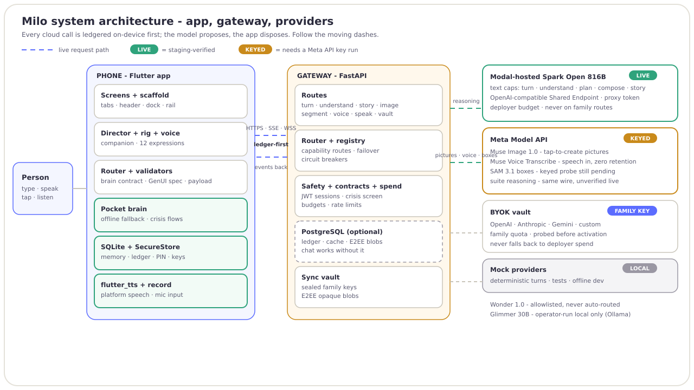</a>
</p>

<p align="center"><em>Phone, gateway, and providers. Green is staging-verified, amber needs a keyed run. Follow the moving dashes.</em></p>

The Flutter app owns the experience (screens, companion director, validators, encrypted storage, pocket-brain fallback) and ledgers every cloud call before sending it. The FastAPI gateway owns auth, contracts, safety screening, capability routing with pre-first-byte failover, and spend guards, and fans out to the Modal-hosted Spark endpoint, the Meta Model API suite, family BYOK providers, or deterministic mocks. The model proposes; both sides validate; the app disposes.

Full detail, including request sequences and the deployment layout, lives in [ARCHITECTURE.md](ARCHITECTURE.md).

## Privacy, safety, offline-first

- Ledger-before-send for every cloud call; per-device consent log; no ads, no analytics, no content in crash reports.
- Crisis and check-in flows are local and hand-written; the model never sees crisis turns as normal input.
- Memories need explicit confirmation, with an on-device viewer and forget commands; sync is E2EE, off by default, and separate from cloud AI permission.
- Photos: originals (EXIF/GPS) are deleted right after prep; resized copies only.
- One offline switch ("Local only. Nothing leaves this phone.") plus per-section offline badges.

<p align="center">
  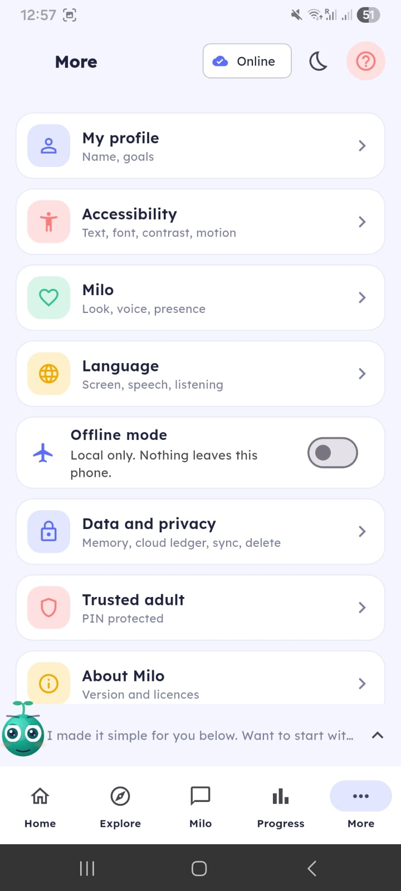
</p>

<p align="center"><em>More: accessibility, language, the offline switch, data controls, and about.</em></p>

Data map: [docs/DATA_MAP.md](docs/DATA_MAP.md). Trust model for family keys: [docs/BYOK.md](docs/BYOK.md).

## Technology stack

- **App:** Flutter (stable) with Riverpod, Dio (SSE/WebSocket), SQLCipher, `flutter_tts`, `record`, ML Kit text recognition.
- **Gateway:** FastAPI on Modal serverless (staging plus production apps), PostgreSQL-optional, JWT sessions.
- **Models:** Muse Spark Open 816B (Modal Shared Endpoint), Muse suite/Image/Voice-Transcribe/SAM via Meta Model API, Glimmer via operator Ollama.
- **Contracts:** `contracts/brain_contract.json` and `contracts/ui_contract.json`, mirrored into Dart and Python with drift-failing tests.
- **CI:** GitHub Actions (gateway tests, analyze, full Flutter suite, staging APK, iOS simulator build).

## Installation and configuration

```bash
# App (repo root)
flutter pub get
flutter run --dart-define=API_BASE=http://10.0.2.2:8000   # against a local gateway

# Gateway
cd gateway
python -m venv .venv && source .venv/bin/activate        # Windows: .venv\Scripts\Activate.ps1
pip install -r requirements-dev.txt
cp .env.example .env                                      # mock mode needs no keys
PROVIDER=mock python -m uvicorn app.main:app_factory --factory --port 8000
```

Step-by-step runbooks: [docs/SETUP.md](docs/SETUP.md) (install), [docs/MODAL.md](docs/MODAL.md) (hosted staging/production), [docs/RELEASE.md](docs/RELEASE.md) (store builds).

Hosted-model configuration (staging secret `milo-gateway-staging`, production `milo-gateway`, plus `milo-models-client` holding the Shared Endpoint URL, proxy token, and model id):

| Variable | Meaning |
|---|---|
| `MODAL_MODELS_URL` | Shared Endpoint base URL |
| `MODAL_MODELS_KEY` | Proxy token (server secret, never in the app) |
| `MODAL_MODEL` | Served model id |
| `MODAL_FALLBACK` | `false` on staging (fail loudly), fallback allowed in production |
| `REASONING_PROVIDER` | `modal` for hosted reasoning |
| `INFERENCE_TIMEOUT_S` | `20` on staging (the 8 s default truncates slow turns) |

Family keys are never configured this way: a trusted adult pastes them in-app (Trusted adult, AI Connections), where each key is sealed server-side, probed for real, and activated per capability.

## Testing, limitations, verification

```bash
cd gateway && python -m pytest -q                       # gateway suite (fast, offline)
flutter analyze                                          # must be clean
flutter test                                             # full app suite; CI always runs it
python gateway/scripts/live_probe.py --photo pic.jpg     # staging live ladder (needs a deploy)
python gateway/scripts/probe_sam.py photo.jpg --concept heart   # SAM keyed check (needs MODEL_API_KEY)
python gateway/scripts/smoke_providers.py                # every configured provider (needs keys)
```

Device ladders before any release claim: [docs/PHONE_CHECKLIST.md](docs/PHONE_CHECKLIST.md), [docs/VOICE_CHECKLIST.md](docs/VOICE_CHECKLIST.md). Never claim a verification that was not run.

Current limitations, stated plainly:

- The staging ladder is green for health, stories, image bytes, and understanding, but the ladder's image step does not pin which provider served the bytes, so keyed Meta Image, Voice, and SAM runs stay recorded as pending.
- The brain-turn step still flakes (empty spoken text roughly one run in eight); the cause is being narrowed from probe timing (see `live_probe.py` comments).
- No device captures yet for Understand, Learn, Chat, or Calm in this pass.
- Wonder is wired and gated to plans/stories but has no keyed run yet; Glimmer runs only as the optional operator-side eval judge (no local Ollama here to verify against).
- `android/app` still uses the template `com.example` application id; `ios/Runner` has no bundle id set. Both must change before any store submission.

## Development and contribution

Repository layout, everyday commands, the testing policy, builds, probes, the Modal workflow, and review rules live in [DEVELOPMENT.md](DEVELOPMENT.md). The short version: keep the contracts closed (new model powers need contract plus validators plus tests on both sides), preserve ledger-before-send and the offline board, run analyze plus both suites before pushing, and ship docs with behavior.

## License

MIT. See [LICENSE](LICENSE).
