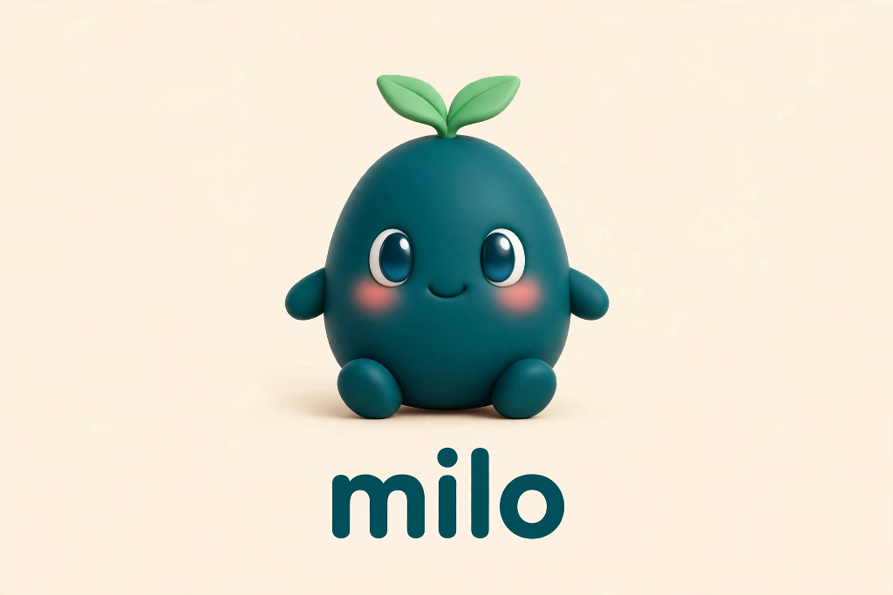
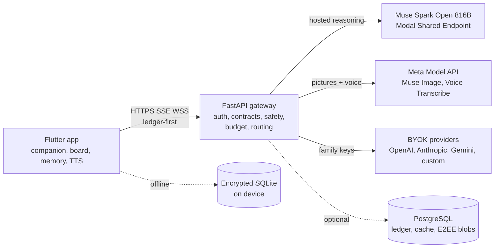

<p align="center">
  <picture>
    <source media="(prefers-color-scheme: dark)" srcset="assets/branding/icon_noti.png" />
    
  </picture>
</p>

<h1 align="center">milo</h1>

<p align="center"><strong>A little help, when words aren&rsquo;t enough.</strong></p>

<p align="center">An adaptive AI companion for communication, comprehension, and everyday independence —<br />for children and adults with dyslexia, speech-language needs, and other communication difficulties.</p>

<p align="center">
  <a href="https://flutter.dev"></a>
  <a href="https://dev.meta.ai"></a>
  <a href="https://modal.com"></a>
</p>

## Demo

<!-- DEMO VIDEO PLACEHOLDER: replace the line below with the 3-minute video link after production.
Suggested markup:
[](https://www.youtube.com/watch?v=REPLACE_ME)
-->

*The 3-minute demo video will be linked here after production.*

## Gallery

Widget-tree captures are generated by `test/screenshots_test.dart` (real
screens, test fakes, no device chrome) — see [`screenshots/README.md`](screenshots/README.md)
for the process, the per-shot index, and the manual device runbook. CI uploads
them as the `milo-screenshots` artifact. The repository ships no fabricated
screenshots; live-backend and device-only shots below are still placeholders.

| Screen | Status |
|---|---|
| Home, chat, understand, board, accessibility, connections, about, GenUI panel | Tester captures in CI artifact (`screenshots/`) |
| Understand with a real worksheet photo | PLACEHOLDER — needs device + vision |
| Loaded AI-drawn picture | PLACEHOLDER — needs Meta Image key + Create tap |
| Voice interaction + transcription | PLACEHOLDER — needs mic + Transcribe key |
| AI Connections with a live BYOK key | PLACEHOLDER — needs a test key, then redact |
| Native splash → intro on a real launch | PLACEHOLDER — needs a device install |

<details>
<summary>Earlier build (pre-rebrand, lavender identity) — real device capture</summary>


Home screen from an earlier Android build: companion stage, greeting, Learn/Say/Do/Settings cards, bottom navigation. The shipped identity is now teal (see `docs/BRAND.md`).

</details>

## What Milo does

**Communicate.** Picture, symbol, and text-based expression: a communication board, message composer, and quick-help phrases that work fully offline, with spoken output and calm, predictable responses.

**Understand.** Help with everyday information: reading and explaining text, documents, and photos — key points, simpler versions, vocabulary checks — with strategies that adapt when something doesn't land.

**Get support.** Practical task assistance: plans broken into steps, guided step mode, trusted-adult controls, quiet mode, and reduced motion — the companion stays present without demanding attention.

One Flutter codebase (Android + iOS) pairs with a FastAPI gateway that reasons through Meta's Muse models — hosted Muse Spark Open for thinking, Muse Image for drawing pictures on request, and Muse Voice Transcribe for listening — plus optional family provider keys. What needs the cloud says so; what works offline just works.

## Overview

Milo helps people **understand** (read and explain text, worksheets, photos), **express** (boards, compose, speech), and **do** (step-by-step plans) — through a companion character that looks, listens, waits, and reacts, instead of a stream of text bubbles. The model decides what to say; deterministic app code decides what happens: every model output is validated against closed contracts before anything reaches the screen, the speaker, storage, or the network.

## The problem

General-purpose chatbots assume fluent reading, typing, and self-direction. Milo's users — a pre-reader child, a teenager with dyslexia, an adult filling in forms, a person who communicates with symbols — need the opposite: spoken interaction, patient pacing, visual structure, huge touch targets, and tools that keep working with no connection. Bolting a character onto a chat API does not get there; the whole interaction model has to be built around communication access.

## Why Milo is different

- **The character is the interface.** A real-time rig with gaze, breathing, blinking, twelve expressions, and screen-aware presence (stage, buddy, chip) — driven by a validated brain-to-body contract, never by raw model output.
- **Generative UI, validated.** Spark returns structured interface specs (checklists, steps, quizzes, visual stories, AI-drawn pictures) that the app validates and renders natively. Invalid specs degrade to chat; the model can never inject code or widgets.
- **Local-first with honest ladders.** Offline, cloud-off, resting, and full-online states each say what works now. The board, read-aloud, routines, and memory never need the internet.
- **Consent is structural.** Cloud ledger before every send, per-device consent log, trusted-adult PIN, E2EE sync as a separate permission, no ads, no analytics, no training on children's data (`-contributor` model IDs are refused at startup).

## Core capabilities

| Area | What Milo does |
|---|---|
| Understand | Explains pasted text, documents, and photos; key points, simple versions, vocabulary checks, strategy switch (simpler / picture / example / short) |
| Express | Symbol communication board, message composer, quick-help phrases, offline TTS with audio-driven lip-sync |
| Do | Task plans broken into steps, guided step mode, celebration, hand-off to Express |
| Chat | Context-aware conversation with the companion, photo questions via Understand, voice input |
| Draw | "Draw a friendly dinosaur" → Spark writes a generation request → tap-to-create → Muse Image draws it, always labeled AI-made with alt text |
| Voice | Push-to-talk transcription (Muse Voice Transcribe, zero-retention flag), platform TTS fallback, neural-voice ready |
| Memory | Explicitly confirmed memories only, on-device viewer, forget commands, cloud ledger |
| Growth | Presence modes, wardrobe colours, progress, calm space, pre-reader mode, switch access |

## Architecture



Full diagrams and layer-by-layer detail: [`docs/ARCHITECTURE.md`](docs/ARCHITECTURE.md).

### End-to-end request flows

**Hosted Muse Spark reasoning.** Chat turn → Core router (safety pre-filter → memory → local intents → cloud) → ledger entry → `POST /v1/brain/turn` (SSE: `risk/body/say/ui/memory/done`) → gateway validates against the brain contract → Modal Shared Endpoint streams JSON → app performs emotion, gesture, speech, and actions. Timeout budget: Flutter 30 s over the gateway's configurable inference deadline (staging 20 s, prod 8 s); failures speak their cause, never silently switch providers.

**Image understanding.** Camera/gallery (OS permission) → on-device prep (1600 px cap, EXIF/GPS wipe, original deleted, offline OCR for read-aloud) → `POST /v1/understand {image_b64}` → vision-capable route → Spark describes/explains → spoken + shown. Bytes never touch disk or synced stores.

**Image generation (Muse Image).** "Draw…" → Spark returns a `genimage` UI node → app validates → panel shows a Create button (explicit consent; nothing auto-draws) → tap → `POST /v1/image` → prompt screened + wrapped in a child-safe cartoon style → `muse-image-1.0` → PNG bytes shown with an "AI-made picture" label and alt text. A Meta Model API key (deployer secret or family BYOK) is required; without one Milo says drawing needs a grown-up to set it up.

**BYOK provider connections.** Trusted adult (PIN) → AI Connections → pick provider, paste key, test with a real probe, activate per capability. Keys are sealed server-side (`KEY_ENC_SECRET`), never logged, never in the app bundle; family spend never touches the deployer budget. Status shows configured / tested / active separately — a saved key alone never reads "connected".

**Offline communication.** Airplane mode → ladder says Offline and lists what works → board, compose, read-aloud, routines, memories, and all animation run from encrypted on-device SQLite + platform TTS. Nothing essential ever requires the gateway, a database server, or a provider key.

## Meta capability matrix

One honest row per Meta model (registry: `gateway/app/providers/meta_catalog.py`, enforced by tests — only staging-verified rows may claim `live`).

| Capability | Model | Route | Status |
|---|---|---|---|
| Reasoning + UI + vision-in | Spark Open 816B (+ 1.3 suite) | Modal Shared Endpoint / Model API | Live on staging |
| Pictures | Muse Image 1.0 | Model API, tap-to-create | Wired, needs keyed run |
| Voice in | Muse Voice Transcribe 1.0 | Model API websocket | Wired, needs keyed run |
| Segmentation + tracking | SAM 3.1 | Model API Responses | Probe only (`probe_sam.py`) |
| Complex agentic turns | Muse Wonder 1.0 | Model API | Allowlisted, unrouted by design |
| Local/edge + eval judge | Muse Glimmer 30B | Ollama/custom endpoint | Operator-run, documented |

Deliberately off: web search grounding, function calling, and file uploads —
live web + arbitrary tools are a safety regression for a children's product
(the structured-output half already ships via JSON schema). Rationale and
enablement paths: [`docs/MULTIMODAL.md`](docs/MULTIMODAL.md).

## Technology stack

- **App:** Flutter (stable), Riverpod, CustomPainter v2 character rig, `sqflite_sqlcipher`, `flutter_secure_storage`, `cryptography`, ML Kit OCR, `record`, `image_picker`
- **Gateway:** FastAPI, Pydantic v2, SQLAlchemy (async), httpx SSE streaming, Modal (staging + prod apps, Dict spend ledger)
- **AI:** Muse Spark Open 816B-A42B (Modal Shared Endpoint, OpenAI-compatible); Muse Image 1.0 + Muse Voice Transcribe 1.0 (Meta Model API); OpenAI/Anthropic/Gemini-compatible BYOK adapters
- **Contracts:** `contracts/brain_contract.json` + `contracts/ui_contract.json`, mirrored in Dart with parity tests
- **CI:** GitHub Actions — gateway pytest, `flutter analyze`, `flutter test`, staging APK with baked-URL verification, iOS simulator build; tagged releases add Play signing + signed IPA paths

## Privacy, safety, accessibility

- Children's data never trains models: `-contributor` IDs refused, zero-retention flag on voice, abuse-monitoring terms recorded per vendor in `gateway/app/datapolicy.py`.
- Crisis and check-in flows are local-first and hand-written, never generated.
- Consent ledger + cloud ledger on-device; trusted-adult PIN gates keys, sync, and sensitive settings.
- Accessibility: Lexend/Atkinson/OpenDyslexic fonts, 90–200% text scaling, 7:1 high contrast, reduce-motion + quiet presence, switch/scanning access, left-handed layouts, tremor-tolerant taps, full screen-reader labels, alt text on every generated picture.
- No camera/mic emotion recognition, no ads, no analytics, no crash-report content.

## Installation and setup

Prerequisites: Flutter stable (3.24+), Python 3.12, Android SDK 34 for Android builds, a Mac with Xcode for iOS builds. Details and troubleshooting: [`docs/SETUP.md`](docs/SETUP.md). Developer workflows: [`docs/DEVELOPMENT.md`](docs/DEVELOPMENT.md).

### Run the Flutter app

```bash
flutter pub get
flutter analyze
flutter test
# Android emulator against a local gateway:
flutter run --dart-define=API_BASE=http://10.0.2.2:8000
```

First launch shows onboarding (~90 seconds, every step skippable, works offline).

### Run the FastAPI gateway locally

```bash
cd gateway
python -m venv .venv && source .venv/bin/activate   # Windows: .venv\Scripts\activate
pip install -r requirements-dev.txt
python -m pytest -q
PROVIDER=mock JWT_SECRET=$(python -c "import secrets;print(secrets.token_urlsafe(48))") \
  python -m uvicorn app.main:app_factory --factory --port 8000
curl localhost:8000/v1/health
```

Mock mode returns deterministic turns — the whole app works end to end with no keys and no credits. Point a phone at it via `adb reverse`, LAN IP, or a tunnel (see `docs/SETUP.md` §1b).

### Modal deployment

Same gateway code, serverless — staging and production are separate Modal apps with separate secrets. Full runbook (dashboard steps, secrets, verification ladder, rollback, teardown): [`docs/MODAL.md`](docs/MODAL.md).

```bash
modal deploy gateway/modal_staging.py        # staging (safe, no confirmation needed)
modal deploy gateway/modal_app.py            # production (only after staging passes)
```

Or dispatch `.github/workflows/modal-deploy.yml` (production requires typing `DEPLOY-PROD` plus passing gateway tests in the same run).

### Hosted Muse Spark

The only Modal-hosted model is `meta-models/Muse-Spark-Open-816B-A42B` behind a Modal-managed Shared Endpoint (created in the dashboard — nothing here deploys weights). The gateway talks to it with an OpenAI-compatible payload plus proxy-token auth; staging is verified with the ladder in `docs/MODAL.md` (health → reasoning model → real completion → SSE → `ui_spec` → `ui_context` → budget). Never substitute another model silently, and never assume the endpoint is ready until its URL + credentials are configured.

### Optional BYOK providers

In-app: More → Trusted adult (PIN) → AI Connections → add provider → paste key → Test connection → activate. Supported: Meta, OpenAI-compatible, Anthropic, Gemini-compatible, custom/local endpoints (LAN allowed in dev only). Trust model and CLI management: [`docs/BYOK.md`](docs/BYOK.md).

### Image generation (separate capability)

Pictures need a Meta Model API key (`dev.meta.ai`) — either the deployer's `MODEL_API_KEY` server secret or, preferably, the family's own BYOK key so shared spend is impossible. No key → Milo says so honestly. Flow, safety wrapper, and costs: [`docs/MULTIMODAL.md`](docs/MULTIMODAL.md).

### Configuration reference

All gateway settings live in `gateway/.env.example` (placeholders only — never real secrets). The ones most people touch:

| Variable | Purpose | Default |
|---|---|---|
| `ENV` / `PROVIDER` | `dev`/`prod`; `mock`/`meta` suite | `dev` / `meta` |
| `MODEL_API_KEY` | Meta Model API key (Image, Voice, suite reasoning) | empty (mock works without) |
| `JWT_SECRET` / `KEY_ENC_SECRET` | Session signing / BYOK vault seal (≥32 chars) | required in prod |
| `DATABASE_URL` | PostgreSQL, or sqlite for dev, or empty (chat still works) | sqlite dev |
| `MODAL_MODELS_URL` / `MODAL_MODELS_KEY` / `MODAL_MODEL` | Shared-Endpoint URL, proxy token, model id | empty / Spark id |
| `REASONING_PROVIDER` | `modal` = hosted Spark for text; empty = suite | empty |
| `INFERENCE_TIMEOUT_S` | Whole-completion hosted deadline | 8 (staging: 20) |
| `DAILY_BUDGET_USD` / `MONTHLY_BUDGET_USD` | Shared-spend guards (family keys exempt) | 20 / 100 |
| `SPEND_BACKEND` / `SPEND_DICT_NAME` | `auto` (postgres → Modal Dict → memory) | auto |

The app takes only `API_BASE` (gateway URL) and optional `HELPLINE` via `--dart-define` — never credentials.

## Testing and verification

- `cd gateway && python -m pytest -q` — contract, safety, routing, providers, budget, streaming, UI-spec suites.
- `flutter analyze` — must be clean. `flutter test` — widget + unit suites (run in CI; needs loopback, unavailable in locked-down sandboxes).
- `python tools/smoke_providers.py` probes every configured provider when keys exist.
- Device ladders: [`docs/PHONE_CHECKLIST.md`](docs/PHONE_CHECKLIST.md) (full pass), [`docs/VOICE_CHECKLIST.md`](docs/VOICE_CHECKLIST.md) (speech lifecycle), [`docs/LAUNCH_CHECKLIST.md`](docs/LAUNCH_CHECKLIST.md) (pre-launch gaps).
- AI eval harness: `eval/run_eval.py` (rule checks; optional Glimmer judge via Ollama).

## Platform support

| Platform | Status | Notes |
|---|---|---|
| Android | Release APK + App Bundle in CI | Adaptive + monochrome icons, Android 12 splash, Play signing optional via secrets |
| iOS | Simulator build in CI; signed IPA path ready | SPM plugin mode (no Podfile by design), AppIcon + LaunchScreen shipped; TestFlight needs signing secrets |
| Windows/macOS/Linux | Not targets | Gateway runs anywhere Python does |

iOS specifics (why Windows can't build it, simulator vs IPA, signing secrets, TestFlight steps): [`docs/RELEASE.md`](docs/RELEASE.md) §4.

## Project structure

```
lib/            Flutter app: companion/ (character engine + Director), core/ (router, memory, safety),
                data/ (encrypted SQLite, secure store), genui/ (generative panel), media/, net/ (API, voice),
                sync/ (E2EE), sys/, ui/ (screens), voice/
gateway/        FastAPI: app/ (routes, providers/, safety, budget, sync), modal_app.py, modal_staging.py,
                scripts/ (smoke probes), tests/
contracts/      brain_contract.json + ui_contract.json (single source of truth, mirrored in Dart)
assets/         branding/ (icon/splash/mascot masters), fonts (OFL), learn/, sounds/
android/ ios/   Committed platform shells (CI refreshes via flutter create; icons+splash regenerate from masters)
deploy/         Docker Compose VPS stack (Caddy + gateway + PostgreSQL)
eval/           AI evaluation harness        tools/  signing helper, legacy art scripts, sound maker
docs/           Guide map below              test/   Flutter unit + widget suites
```

Docs map: `ARCHITECTURE.md` (system design) · `DEVELOPMENT.md` (contributor setup) · `SETUP.md` (install) · `MODAL.md` (serverless) · `RELEASE.md` (store releases) · `BYOK.md` (family keys) · `GENUI.md` (UI protocol) · `MULTIMODAL.md` (vision/voice/pictures) · `BRAND.md` (identity) · `SYNC_DESIGN.md` · `DATA_MAP.md` · `THIRD_PARTY.md` · `VOICE_CHECKLIST.md` · `PHONE_CHECKLIST.md` · `LAUNCH_CHECKLIST.md` · `CHARACTER_RIG_SPEC.md` · `DESIGN_MAP.md` · `DEPLOYMENT.md` · `7_13_NATIVE.md` · `upgrade/` (phase reports).

## Evolution: plan → hackathon → now

The architecture blueprint (`Milo_Architecture_and_Build_Plan.docx`, v1.0, 23 Oct 2026) and the wireframe journey maps (`0_…png`–`5_….png`) pre-date the build window: they defined the personas, the Understand/Express/Do model, the brain-to-body contract, the P0/P1/P2 scope tiers, and the Rive-first character plan. All 72 git commits fall inside the hackathon window (27 Oct–1 Nov 2026).

| Area | Original plan | What changed during the build |
|---|---|---|
| Reasoning | Spark 1.3 via Meta Model API | Modal-hosted **Muse Spark Open 816B** Shared Endpoint is primary; Model-API suite kept for Image/Voice + BYOK |
| Character | Rive rig (CustomPainter fallback) | Shipped the code-drawn **v2 renderer** (breathing, gaze, 12 expressions); Rive spec kept for a later swap-in |
| Pictures | Pre-generated art, fixed concepts | **Live Muse Image generation** with consent tap, disclosure, alt text — plus the fixed-concept `/visual` path |
| UI model | Fixed screens + wireframes | **Generative UI protocol**: model-composed, app-validated panels (11 components, atomic updates) |
| Providers | Meta suite first | Hosted Spark + full **BYOK router** (Meta/OpenAI/Anthropic/Gemini/custom) with vault, probing, honest statuses |
| Voice | Voice Transcribe realtime | Implemented end to end (needs keyed verification); platform TTS + audio-lifecycle lip-sync verified in design |
| Identity | Lavender concept | **Teal/clay rebrand**: mascot, wordmark, adaptive + iOS icons, splash, calm intro veil |
| Releases | Manual builds | CI: per-push tests + staging APK + iOS simulator; tagged releases with signing-gated Play/IPA paths |

Deliberately **not** built (plan said stretch/post-hackathon): SAM 3.1 app path (probe + overlay renderer exist; the route lands after `probe_sam.py` verifies the wire format), on-device STT, widget/keyboard surfaces. Muse Wonder is allowlisted but unrouted (see below).

## Current limitations and roadmap

- Staging vision + keyed Meta Image/Voice turns are implemented but await live verification runs (ladders in `docs/MODAL.md`, `docs/MULTIMODAL.md`).
- Bundle/application IDs are still `com.example.milo` placeholders — set real IDs before any store submission (secrets-driven, see `docs/RELEASE.md`).
- No `LICENSE` file yet (see below — owner decision).
- Fresh device screenshots + demo video pending (placeholders above).
- Roadmap: keyed verification passes, real-ID release cut, SAM grounding only if a verified endpoint appears, Rive swap-in behind the same `DirectorFrame` contract, extended Indic-language coverage.

## Hackathon

Built for the **Meta Global AI Developer Hackathon** (build window 26 Oct – 4 Nov 2026) by Arjun.

- **Problem alignment:** communication access for people whom chatbots leave behind — dyslexia, speech-language needs, pre-readers, symbol communicators.
- **Meta models, used as designed:** Muse Spark Open 816B plans, reasons, and composes structured UI (hosted on Modal); Muse Image renders requested pictures (Meta Model API, separate capability with its own consent, budget, and error path); Muse Voice Transcribe turns speech into text (zero-retention flag). Text stays with Spark, pixels with Image, audio with Transcribe — never blurred.
- **Muse Wonder (allowlisted, unrouted):** the plan evaluated Wonder and declined it, and Milo's turns remain small, structured, and latency-sensitive — Spark Open clears the bar at a fraction of the $4/$20 cost. The id is allowlisted so a deployer can deliberately set `SPARK_MODEL=muse-wonder-1.0` for hard planning tasks; nothing routes there silently.
- **More than a chatbot integration:** a validated brain-to-body contract, a generative native UI protocol, a multi-provider router with spend guards, E2EE sync, an offline-first ladder, and a character engine — with the model proposing and deterministic code disposing at every boundary.
- **New in window:** everything in git history (72 commits, 27 Oct–1 Nov); pre-existing: the 23 Oct blueprint, wireframes, and concept art.

## License and contributing

**No license file exists yet.** Until one is added, all rights remain reserved with the author by default — do not treat the code as open for reuse. Before going public, pick one: MIT (permissive, simplest for a hackathon repo), Apache-2.0 (permissive + patent grant), or GPL-3.0 (copyleft). Say the word and it will be added with headers.

Contributions: see [`docs/DEVELOPMENT.md`](docs/DEVELOPMENT.md) for setup, test, and PR workflow. Fonts are OFL-licensed (see `assets/fonts/OFL-*.txt`); third-party components and licences are inventoried in [`docs/THIRD_PARTY.md`](docs/THIRD_PARTY.md).
