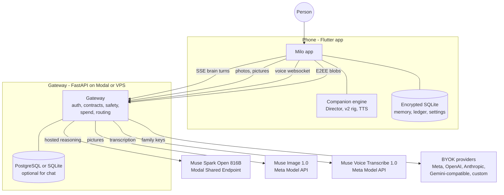
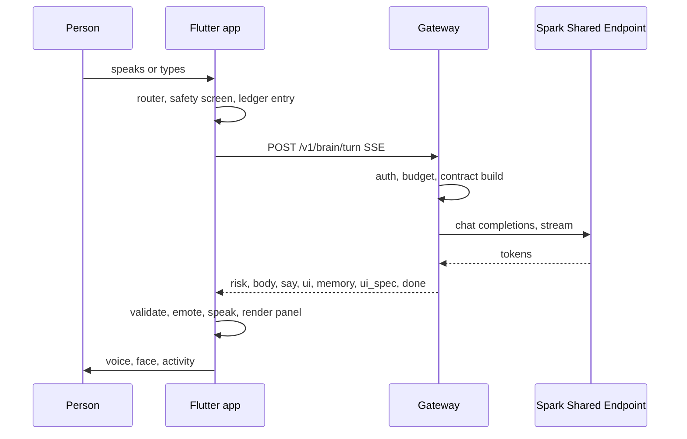
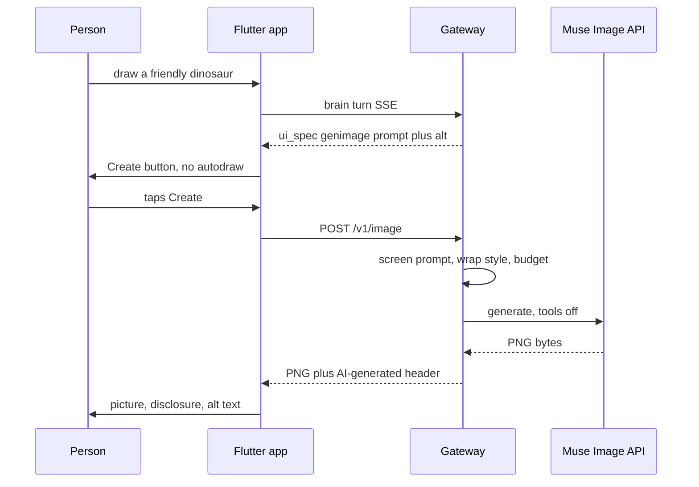
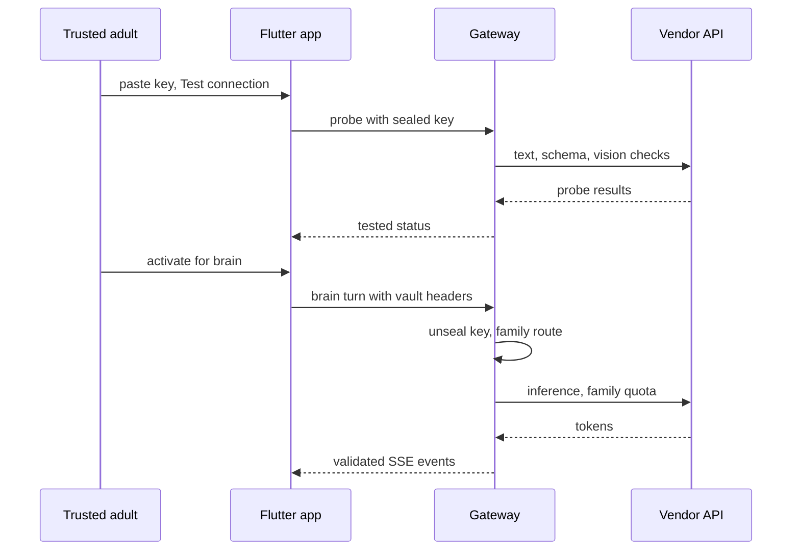

# Milo architecture

How the system fits together: Flutter app, FastAPI gateway, Meta models on
Modal and the Model API, BYOK routing, offline operation, and the safety
boundaries between them. For setup and workflows, see
[`DEVELOPMENT.md`](DEVELOPMENT.md); for install/runbooks,
[`SETUP.md`](SETUP.md), [`MODAL.md`](MODAL.md), [`RELEASE.md`](RELEASE.md).

## 1. System architecture



Design rules: the model proposes, the app disposes (every model field is
validated against closed contracts); ledger-before-send (every cloud call is
recorded on-device first); offline-first (nothing essential needs the
gateway); no silent fallbacks (a failed provider errors honestly in words).

## 2. Flutter application layers

```
lib/
  main.dart            Gate (onboarding check + intro veil), Shell (tabs, ticker, ladder speech)
  companion/           Director (single writer of companion state), emotion, greetings,
                       milo_view (touch -> reactions), v2/ (code-drawn rig: frame, renderer)
  core/                providers (router, ladder, panel, vault wiring), payload (request
                       bodies + ledger summaries), memory, pocket_brain (offline fallback),
                       ai_provider (hosted/family choice), safety
  contracts/           brain_contract (turn validator), events (SSE event model)
  genui/               spec (UI-spec validator), panel (state + ops), widgets (registry)
  data/                MiloDb (SQLCipher), SecureStore (PIN, keys)
  net/                 api (Dio client, ledger-first, timeouts), voice (mic websocket)
  media/               photo prep (resize, EXIF wipe)      sync/  E2EE sync service + crypto
  ui/                  screens, scaffold (header, dock, rail), theme, intro, brand
  voice/               TTS normalization + output lifecycle
```

- **Core router** (`core/providers.dart`): each turn tries local safety
  pre-filter → memory commands → local intents → cloud brain → pocket brain,
  in that order. Document chips (`You are reading this now`) scope follow-ups.
- **Director** (`companion/director.dart`): owns emotion, gesture, gaze,
  speech, and presence; paints only from `DirectorFrame`. Speech follows the
  audio lifecycle, never animation timers (`VOICE_CHECKLIST.md`).
- **Ladder** (`full/cloudOff/offline/resting`): one status chip + spoken
  words per state; inference trouble never claims the network is down.
- **Timeouts:** connect 8 s, send 15 s, receive 30 s — the receive side stays
  above the gateway's inference deadline with room for error handling.

## 3. Gateway and provider abstraction

```
gateway/app/
  main.py        app factory, lifespan, default routes per capability
  routes.py      /v1/session|health|brain/turn|understand|plan|compose|visual|image|voice|sync/*|connections/*
  prompts.py     five-layer prompt builder (persona, context, history, document, media note)
  contract.py    brain + UI contracts loaded from contracts/ (single source of truth)
  models.py      request shapes (BrainReq, UnderstandReq, VisualReq, ImageReq, ...)
  ui_spec.py     UI-spec sanitizer (returns None on unusable specs — never breaks a turn)
  safety.py      crisis screen, Assembler (streams validated SSE events), PII/URL stripping
  routing.py     capability router: ordered entries, pre-first-byte failover, circuit breakers
  providers/     meta (Model API suite), modal_hosted (Spark Shared Endpoint),
                 openai_compat, anthropic, mock + registry, capabilities, probes
  spend.py       daily/monthly ledger (postgres → Modal Dict → memory, always capped)
  security.py    JWT sessions, rate limits      sync.py  vault contexts + E2EE blob store
  streaming.py   SSE/JSON parsers               datapolicy.py  per-vendor training/retention terms
```

Capabilities route independently: `brain`, `understand`, `plan`, `compose`
need `text_stream` (+ `vision` when a photo rides along); `visual` needs
`image_gen`; `stt` needs `audio_in`. Each capability has an ordered route
list of `(provider, model)`; failover retries the next entry only before the
first byte and only for timeout/429/5xx/unreachable. Auth, content-filter,
and post-first-byte errors propagate immediately. Circuits open after 3
failures in 60 s. Clients never choose providers; the server uses saved routes.

## 4. Modal-hosted Muse Spark Open

Primary reasoning: `meta-models/Muse-Spark-Open-816B-A42B` behind a
Modal-managed Shared Endpoint (OpenAI-compatible chat completions, proxy-token
auth, server-side only). No weights are deployed by this repo; the endpoint is
created in the Modal dashboard. The `ModalAdapter` sends a stock OpenAI
payload (reasoning-cap bumped to 2000 tokens — Spark reasons out loud and the
shared 900-token default truncated live turns mid-JSON).

Staging and production are separate Modal apps (`modal_staging.py`,
`modal_app.py`) with separate secrets; staging sets `MODAL_FALLBACK=false`
and `INFERENCE_TIMEOUT_S=20` so hosted behaviour is tested loudly. Full
runbook and the 7-step verification ladder: [`MODAL.md`](MODAL.md).

## 5. Image generation (separate capability)

Pictures are drawn by `muse-image-1.0` (Meta Model API), never by Spark, and
Milo never claims otherwise. Flow: Spark writes a `genimage` UI node →
gateway + client validators check it → the panel shows a Create button
(explicit consent; nothing auto-draws) → tap → `POST /v1/image` screens the
prompt (deny-list, 140-char cap) and wraps it in a fixed child-safe cartoon
style (never photorealistic, no text, no real people) → provider bytes return
with an `X-Milo-Image: ai-generated` header → panel shows the picture with an
"AI-made picture" label and model-written alt text (fallback synthesized when
missing). Bytes live in a memory-only provider; the server caches by content
hash for cost control with no user link. Agentic tool use (web/image search,
shell) is disabled and reasoning is low: a picture request must not browse or
run code. Credential: deployer `MODEL_API_KEY` or family BYOK Meta key; with
neither, Milo says drawing needs a grown-up to set it up.

## 6. BYOK vault and routing

Families connect their own provider keys in-app (Trusted adult → AI
Connections, PIN-gated): pick provider, paste key, run a real probe (text,
schema, vision checks), activate per capability. Keys are sealed at rest with
`KEY_ENC_SECRET`, travel per-request in vault headers over TLS, and never
appear in logs, bundles, analytics, or crash reports. Family turns spend the
family's quota and skip the deployer budget; there is no deployer fallback on
family requests. Status shows configured / tested / active separately — a
saved key alone never reads "connected". Trust model: [`BYOK.md`](BYOK.md).

First-party Meta surface (endpoint, model, creds, cost, honesty status per
capability) is data, not prose: `gateway/app/providers/meta_catalog.py`
(`live` only for staging-verified rows, enforced by tests).

## 7. Local and offline functionality

Without any connection: the Express board, composer, quick help, routines,
memories, read-aloud (platform TTS + on-device OCR), the full character, and
the pocket brain (hand-written local flows incl. crisis support) all run from
encrypted on-device SQLite. Cloud sync is optional, off by default, E2EE
(server sees opaque blobs only), and a separate permission from cloud AI
(`SYNC_DESIGN.md`, `DATA_MAP.md`). The gateway itself is database-optional:
with no `DATABASE_URL`, chat, hosted AI, and BYOK work; vault/sync report
honestly unavailable.

## 8. Generative UI contract and validation

Spark may attach a `ui_spec` object to any turn: `{v, activity, intent,
mode, companion, speak, state, root, ops}`. Eleven component types (`text`,
`card`, `button`, `choices`, `checklist`, `progress`, `steps`, `list`,
`image`, `genimage`, `divider`), six closed actions, six patch ops
(`add/update/replace/move/remove/state`), stable ids preserved across turns,
atomic batches, ≤40 nodes, depth ≤4, flat scalar `ui_context` (≤12 keys).
Both validators (gateway `ui_spec.py`, client `genui/spec.dart`, parity-tested)
sanitize every string; anything malformed degrades to classic chat — the turn
never breaks. `image` nodes use the visual-concept allow-list; `genimage`
nodes carry `{prompt, alt}` for the flow in §5. Full protocol:
[`GENUI.md`](GENUI.md).

## 9. Privacy, consent, safety, spending

- Ledger-before-send for every cloud call; per-device consent log; PIN-gated
  grown-up area; no ads/analytics; crash reports carry no content.
- Crisis/check-in flows are local and hand-written; the model never sees
  crisis turns as normal input.
- `-contributor` model IDs refused at startup; voice requests zero data
  retention; photo originals (EXIF/GPS) deleted right after prep.
- Spend: daily + monthly deployer guards, per-request metering, persistent
  ledger when a database exists, capped ephemeral memory ledger otherwise
  (`EPHEMERAL_DAY_USD=5`), Modal Dict backend on serverless. Family keys
  exempt by design. Budget trips speak plainly and drop to the pocket brain.

## 10. Error handling, timeouts, provider failure

Timeout chain (whole-completion unless noted): Flutter receive 30 s >
gateway `INFERENCE_TIMEOUT_S` (staging 20 s, prod 8 s) wrapping provider
selection + the full token stream > httpx connect 10 s + read/write at the
deadline. `POST /v1/brain/turn` always returns HTTP 200 with mid-stream
`error` events on failure — the app maps codes to spoken words
(`timeout`, `budget_exhausted`, `auth_failed`, `quota`, Spark-specific
wording for hosted timeouts) and the pocket brain keeps helping. Image turns
get 60 s; voice sockets 5–15 s per leg. Gateway offline vs inference trouble
stay separate in both UI and words.

## 11. Request sequences

### Text reasoning turn (hosted Spark)



### Image generation turn (Muse Image)



### BYOK provider routing


